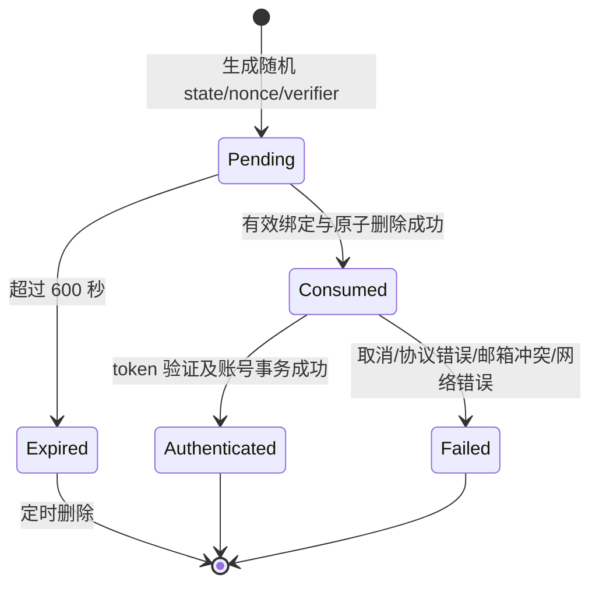

# Phase 1 Data Model

本模型对应 [spec.md](spec.md) FR-004～FR-011、FR-015；接口规则见 [contracts/oidc.md](contracts/oidc.md)。本次仅定义设计，不包含 migration 实现。

## 1. OIDCProviderConfiguration（复用 InfraConfig）

每个实例一份活动配置，行名扩展 `InfraConfigEnum`，运行时由 `INFRA.*` 加载。完整字段、默认值见 [配置契约](contracts/configuration.md)。

- `issuer` 保留完整标识字符串，作为 discovery 和 token 的 expected issuer。
- `discoveryUrl?` 只决定从哪里读取 metadata，不替代 issuer。
- `clientId`、加密 `clientSecret`、认证方式、scope、派生 callback、HTTP 选项共同构成配置版本指纹。
- 配置修改经现有受保护接口保存，重启生效；旧事务指纹不匹配即失效。

## 2. OIDCIdentity（复用 Account）

| 字段 | 规则 |
|---|---|
| `provider` | 固定小写 `oidc`；公开 provider 标识为大写 `OIDC` |
| `providerAccountId` | `JSON.stringify([issuer, sub])`，顺序固定，两个元素都为非空字符串 |
| `userId` | 关联已有 User.uid |
| `providerAccessToken` / `providerRefreshToken` | OIDC 行始终 null，不存 IdP token |
| `providerScope` | 可记录实际 scope 字符串，不承载身份或邮箱信任数据 |
| `loggedIn` | 使用既有字段更新最近登录 |

复用现有唯一约束 `(provider, providerAccountId)`，无需改变 Account 表结构。JSON 元组编码避免简单分隔符连接产生碰撞；不对 `sub` 或 issuer 做小写、去尾斜杠处理。

身份查找发生在邮箱查找之前。相同 subject、不同 issuer 是不同身份；相同邮箱不代表相同身份。新身份的邮箱已被使用时拒绝建号，不能把另一个账号接入该身份。

## 3. User（小范围扩展）

保持既有 `uid`、nullable unique `email`、displayName、photoURL、isAdmin、refreshToken 等字段，新增：

| 字段 | 类型 | 规则 |
|---|---|---|
| `emailVerified` | Boolean，非空，默认 false | 资料状态，绝不作为 OIDC 登录门槛或自动关联许可 |

新 OIDC 身份首次登录：

1. 必须有合法 email。按仓库现有语义作 trim 和不区分大小写的冲突检查，新 OIDC 写入使用一致的规范形式；不要求邮件域名存在公网 DNS/MX，也不发验证邮件。
2. email 和 `email_verified` 必须来自同一份已验证 ID token，或 subject 已匹配的同一份 UserInfo。若 UserInfo 提供 email 则采用该来源整组字段；否则采用 ID token 整组字段。严格布尔 `true` 才记为已验证，字符串 `"true"` 不算。
3. User 和 Account 在同一事务中创建。邮箱冲突返回受控错误，不创建 null/占位邮箱账号。
4. 显示名称取 `name` → `preferred_username` → email；不获取或保存远程 `picture`，沿用本地头像。
5. `isAdmin=false`，只有既有管理员初始化流程能提升；不从 groups/roles 映射。

已有身份：始终使用已绑定 userId，不自动更换邮箱；只有同一邮箱来源对应当前本地邮箱时才同步验证标记。资料缺失或未验证均不阻断登录。

旧行迁移：有邮箱的旧用户保留当前客户端原有的“已验证”展示假设；空邮箱旧行记 false。这是兼容迁移，不是对历史邮箱做新的真实性证明。既有 magic-link 成功验证及 SSO 路径维护该字段，保持原登录行为。GraphQL `User` 新增 `emailVerified: Boolean!`，客户端不再硬编码 true。

为满足本次范围，不调整 User.email 既有 nullable schema，也不开展无邮箱用户的界面和团队管理改造。

## 4. OIDCLoginTransaction（新增短期表）

| 字段 | 类型/索引 | 内容 |
|---|---|---|
| `id` | String 主键 | SHA-256(raw state)，raw state 使用至少 256 bit 随机值 |
| `browserBindingHash` | String | SHA-256(独立 256 bit cookie 随机值) |
| `encryptedContext` | String | 使用既有 encrypt/decrypt 工具加密的版本化 JSON |
| `configFingerprint` | String | 活动配置指纹，用于拒绝配置切换前的事务 |
| `createdAt` | DateTime | 创建时间 |
| `expiresAt` | DateTime，索引 | 创建时间 + 600 秒 |

加密 context 包含 `version`、nonce、PKCE verifier、expected issuer/clientId、固定 callback URL、已校验的 app/admin 返回目标。cookie 按 state 哈希前缀独立命名，仅保存绑定随机值；host-only、HttpOnly、SameSite=Lax、callback path、十分钟有效；HTTPS 使用 Secure。

消费顺序：解析单值参数 → 定位事务 → 检查 cookie 哈希、有效期、配置指纹 → **带条件原子删除，且影响行数必须为 1** → 解密并校验 token。无有效绑定不能删除其他浏览器事务；有效绑定的 provider error 也应消费事务。成功和可定位的失败均清除对应 cookie。失败后重新发起登录，不重用已消费 state。

数据库中只留 pending 行；Consumed 等为逻辑状态，无须持久化审计记录。每五分钟清理过期行，最迟十五分钟清除；多副本重复清理安全。不记录 state、cookie、verifier、claims 全文或 token。所有副本共用数据库和 DATA_ENCRYPTION_KEY。

## 5. 原子性与升级

- 新增短期表和 User.emailVerified 的前向 migration；旧业务数据及 Account 身份不重写。
- 同身份并发首次登录依赖唯一约束和受控重试：回滚失败建号事务，重新读取**同一完整身份**，不能按邮箱兜底。
- 不同身份的同邮箱并发只允许一个建号成功，另一个返回冲突；覆盖大小写邮箱和现有账号的冲突检测。
- 所有邮箱自动关联入口在操作前检查目标账号的 OIDC 关联；OIDC 用户不允许首次自动挂入旧 provider/magic 身份。纯既有账号的关联行为保持兼容。
- 回退应用前先关闭 OIDC；保留新增表/列比删除身份数据更安全。清空临时事务不会影响已签发本地 JWT；无需持有 IdP refresh token。

## 6. 本地会话生命周期（复用既有存储）

本地会话使用既有签名 JWT 和 `User.refreshToken`，不需要新增会话表或 IdP 禁用状态字段。一次性 OIDCLoginTransaction 只约束授权码流程，消费/过期不影响已经签发的本地会话。

| 事件 | 状态变化 |
|---|---|
| OIDC 登录成功 | 为绑定 User 签发本地 access/refresh，覆盖该 User 当前 refresh 哈希 |
| 本地 access 过期 | 后续使用该 access 被拒绝；仍有效的本地 refresh 可签发新令牌 |
| 本地 refresh 成功 | 验证本地 JWT 和用户、校验当前哈希，随后复用既有签发逻辑并覆盖哈希；新令牌使用既有载荷和有效期配置 |
| IdP 禁用用户 | 新 OIDC 授权由 IdP 拒绝；已有本地 JWT 和 refresh 哈希保持原状态 |
| IdP 暂不可达 | 新 OIDC 登录按网络失败处理；有效本地会话和刷新按既有规则继续 |
| 当前客户端退出 | 清除该客户端凭据；后端 logout 不清 User.refreshToken，不保证其它客户端或复制令牌被撤销 |
| 删除本地 User | 既有用户查找失败，后续受保护请求和刷新均拒绝 |

User.refreshToken 按用户只保存一个 Argon2 哈希，沿用现有校验后更新流程；哈希不匹配的 refresh 被拒绝。重新计算哈希不构成“token 值每次必定不同”的承诺，本次不新增 jti、按设备会话或并发单次刷新机制（FR-010）。授权事务 state 的原子单次消费要求保持有效。

本地刷新不查询 IdP；持续刷新可延长会话，首版没有因 IdP 禁用而触发的固定失效时限。验收应同时覆盖新登录拒绝、已有 access 可用、既有刷新及哈希不匹配时拒绝、本地用户删除后的拒绝行为（FR-015 / SC-006）。
