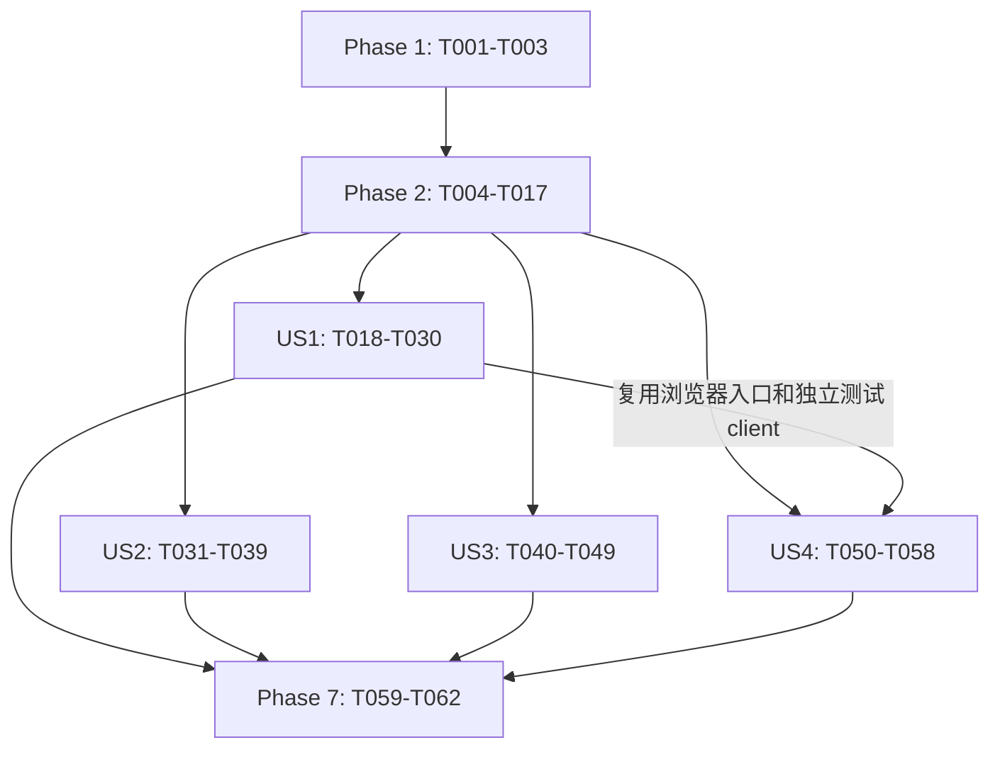

# Tasks: 通用 OIDC 自托管登录

**Branch**: `feature/oidc`

**Input**: [spec.md](spec.md)、[plan.md](plan.md)、[research.md](research.md)、[data-model.md](data-model.md)、[contracts/](contracts/)、[quickstart.md](quickstart.md)。

**用户补充**: 使用 `.13` 上的既有 authentik 验证，完整入口为 `https://auth.ihxq.fun:9999`。

**Tests**: spec FR-013 明确要求真实 authentik 验收和独立可控 IdP 负面测试，因此本清单包含测试任务。故事内先写对应测试，再实现并通过；共享基础提供安全的最小登录链路。

**Organization**: 按四个用户故事分组。所有任务当前均未执行；实机可用性、凭据、登录结果不得预填为成功。

## Format & Path Conventions

- 任务格式为 `- [ ] Tnnn [P?] [USn?] 描述及路径`；路径均相对仓库根目录。标明“新增”的文件在实施时创建。
- `[P]` 只表示完成共同前置后，不同文件之间可以并行。默认按编号执行；显式依赖和下方并行窗口优先，不将共享文件修改并行处理。
- Setup、Foundational、Polish 不标故事标签；故事阶段每项必须包含 `[US1]`～`[US4]`。
- constitution 当前仍为未填写模板，不将其中的示例测试/审批规则当作已批准要求。
- 首次建号需要合法邮箱，允许 `email_verified=false` 或缺失，不验证 MX/收信能力、不依赖 SMTP；已有身份按 `(issuer, sub)` 登录。完全无邮箱建号、账号合并、IdP 禁用后的主动撤销不在范围。

## Validation Target

优先复用 `https://auth.ihxq.fun:9999`，保留域名和端口进行 issuer、TLS 和 callback 检查。入口地址不是 issuer；测试 Application 建好后，从实际 metadata 取得 issuer / discovery URL，禁止把域名根地址直接当应用级 issuer。

生成任务时一次匿名 HEAD 请求在当前执行环境返回 `Could not resolve host`；这是当前环境的 DNS 检查结果，不代表服务故障，也不代表已完成实机验证。实施时分别验证主机、浏览器和 backend 容器的 DNS、路由及证书信任；需要内网映射时保留原始域名校验证书，不猜测完整 `.13` 地址，不使用跳过 TLS 验证参数。

测试使用独立 Application / confidential client 和测试用户，正常业务 provider、签名密钥和用户策略保持原状。client secret、用户口令、cookie、token 存在本机受忽略的配置或当前会话，不写入文档。只有实机任务依赖该环境与凭据，代码和本地 fixture 可先完成。

SC-002 的私有 CA 必须取得 authentik 实机证据。T036 负责准备隔离私有 CA/HTTP 入口，T038 负责验证信任成功和未信任/移除失败；目标现有入口若使用公共 CA，则给独立测试应用使用单独代理入口或同版本测试实例，不替换业务证书。测试 metadata、issuer、授权/token/JWKS/UserInfo 必须实际使用该入口；本地 fixture 或仅给 Hoppscotch 自身 HTTPS 配私有 CA 均不能替代此项。

## Phase 1: Setup（共享准备）

**Purpose**: 固定验证环境、依赖与可控 IdP；不新建应用架构。

- [X] T001 [P] 新增 `specs/001-generic-oidc/validation.md` 的待执行记录，登记目标 `https://auth.ihxq.fun:9999`、当前 DNS 检查结果、待采集的 authentik 版本/镜像 digest、测试 app、实际 issuer/discovery、callback 和网络规则；真实值须在验证时采集，秘密不入文档，不能将待执行项目记为通过。
- [X] T002 [P] 在 `packages/hoppscotch-backend/package.json` 和 `pnpm-lock.yaml` 精确加入 `openid-client@6.8.8`；沿用 `.github/workflows/tests.yml` 当前 Node 22 和生产镜像现有 Node 24，记录实际版本并在 T017 验证真实库加载；满足直接 require(esm) 路径的依赖兼容要求，不为本功能升级 Node、扩大全仓矩阵或修复历史 Node 24 故障，保持 backend CommonJS 和既有 pnpm 10.34.5。
- [X] T003 [P] 新增 `packages/hoppscotch-backend/test/oidc/fixtures/provider.mjs`，用本地受控 authorize/token/JWKS/UserInfo endpoint 提供授权码、S256、RS256、basic/post、可配置 claims/拒绝/延迟/轮换及 HTTP/测试 CA 模式；所有开关仅属测试 fixture，默认不访问公网或真实用户。

## Phase 2: Foundational（所有故事的共同前置）

**Purpose**: 完成安全的后端基础链路、身份边界和客户端契约；US1～US4 均依赖此阶段。

- [X] T004 在 `packages/hoppscotch-backend/prisma/schema.prisma` 和新增 `packages/hoppscotch-backend/prisma/migrations/20261027000000_oidc_auth/migration.sql` 扩展模型：User.emailVerified 为“Boolean，非空，默认 false”，旧有邮箱行保留既有已验证展示、旧空邮箱行 false，保持“nullable unique email”；OIDCLoginTransaction 的 id 为“String 主键”“SHA-256(raw state)，raw state 使用至少 256 bit 随机值”，browserBindingHash 为“String”“SHA-256(独立 256 bit cookie 随机值)”，encryptedContext 为“String”“使用既有 encrypt/decrypt 工具加密的版本化 JSON”，configFingerprint 为“String”“活动配置指纹，用于拒绝配置切换前的事务”，createdAt 为“DateTime”“创建时间”，expiresAt 为“DateTime，索引”“创建时间 + 600 秒”；不重写旧 Account，随后执行 prisma generate。
- [X] T005 新增 `packages/hoppscotch-backend/src/auth/oidc/oidc.types.ts` 定义客户端 adapter、已验证 claims、版本化私密上下文和完整配置契约；在 `src/auth/helper.ts` 增加 AuthProvider.OIDC，在 `src/types/InfraConfig.ts` 增加配置契约全部 OIDC 键，在 `src/user/user.model.ts` 暴露“emailVerified: Boolean!”；User/Account 关系和 nullable email 形状保持兼容。
- [X] T006 在 `packages/hoppscotch-backend/src/infra-config/infra-config.service.spec.ts` 先补配置契约测试：更新后的完整配置校验、OIDC-only/无 SMTP、client secret 加密、派生 callback/子路径、issuer 尾斜杠、scope 必含 openid、basic/post 枚举、HTTP 默认拒绝和开关显式 true；记录未实现的失败用例。
- [X] T007 在 `packages/hoppscotch-backend/src/infra-config/helper.ts`、`infra-config.service.ts`、`dto/onboarding.dto.ts` 和新增 `src/auth/oidc/oidc-config.ts` 实现配置默认/缺失键补齐/required keys/isServiceConfigured、完整更新校验和只读派生 callback；OIDC_SCOPE 默认 `openid,profile,email`，认证默认 client_secret_basic，HTTP 默认 false，保留 issuer 完整字符串和尾斜杠，可选 discovery 不替代 expected issuer；保存沿既有重启生效，禁用 mailer 时不初始化或要求 SMTP。
- [X] T008 [P] 新增 `packages/hoppscotch-backend/src/auth/oidc/oidc-client.adapter.ts` 的可运行默认 issuer/basic 链路：按需加载 openid-client 6，Authorization Code + S256 + state + nonce，必须有 ID token、非空 issuer/sub，显式 enableNonRepudiationChecks + RS256/JWKS 和标准 claims 校验；从固定配置生成 token callback，私有 CA 走 Node 启动信任，HTTP 仅按单配置显式放行，登录不获取远程 picture、不阻塞 backend 启动。
- [X] T009 [P] 新增 `packages/hoppscotch-backend/src/auth/oidc/oidc-transaction.service.ts` 实现 pending 事务创建和消费；私密 context 包含 version/nonce/verifier/expected issuer/clientId/固定 callback/可信返回入口，cookie 满足“host-only、HttpOnly、SameSite=Lax、callback path、十分钟有效；HTTPS 使用 Secure”，不同事务独立 cookie；按绑定/TTL/指纹执行“带条件原子删除，且影响行数必须为 1”，错误绑定不能删除他人事务，verifier 不进入 URL state。
- [X] T010 [P] 新增 `packages/hoppscotch-backend/src/auth/oidc/oidc-identity.service.ts`：Account.provider 为“固定小写 oidc；公开 provider 标识为大写 OIDC”，providerAccountId 为“JSON.stringify([issuer, sub])，顺序固定，两个元素都为非空字符串”，userId 为“关联已有 User.uid”，provider token 字段满足“OIDC 行始终 null，不存 IdP token”，scope“可记录实际 scope 字符串，不承载身份或邮箱信任数据”，loggedIn“使用既有字段更新最近登录”；身份先查，新 User/Account 同事务创建，邮箱不区分大小写查冲突，冲突拒绝且不建 null/占位邮箱账号，isAdmin=false，displayName 取 name→preferred_username→email。
- [X] T011 新增 `packages/hoppscotch-backend/src/auth/oidc/oidc-account-linking.service.ts`，接入 `src/auth/strategies/google.strategy.ts`、`github.strategy.ts`、`microsoft.strategy.ts` 与 `src/auth/auth.service.ts` 的 magic-link 入口，禁止凭同邮箱首次反向挂入 OIDC 账号；保留纯既有账号的已有登录/关联行为，错误不泄漏账号权限或部分写入。
- [X] T012 在 `packages/hoppscotch-backend/src/user/user.service.ts` 和 `src/auth/auth.service.ts` 维护新增 emailVerified：OIDC 仅同一可信邮箱来源的严格布尔 true 记已验证，false/缺失/字符串 true 均不妨碍登录；既有 magic-link 只在成功验证后维护状态，旧 SSO 路径保留现有展示语义；不改变既有邮箱或权限策略。
- [X] T013 新增 `packages/hoppscotch-backend/src/auth/oidc/oidc-auth.service.ts` 串联 adapter、事务和身份服务；正常及 IdP error 回调均遵循绑定和单次消费，成功后复用 AuthService.generateAuthTokens/last login，已有身份“不自动更换邮箱；只有同一邮箱来源对应当前本地邮箱时才同步验证标记”，不重新要求邮箱验证，不保存 IdP refresh/ID token。
- [X] T014 在 `packages/hoppscotch-backend/src/auth/auth.controller.ts`、`auth.module.ts`、`src/errors.ts` 和 `src/main.ts` 接入 begin/callback 及公开 providers 的 OIDC 标识；启用判断先于网络，保护已有 allowlist 和限流，固定可信 app/admin 返回入口，query 单值解析、拒绝 code/error 冲突，返回契约 400/401/409/429/503，设置 no-store/no-referrer，日志脱敏 callback query/cookie/token，错误回调保留有效的已有本地会话，schema 生成不初始化 IdP。
- [X] T015 按顺序执行 prisma generate、根 gen-gql、admin 和 selfhost gql-codegen，更新 `gql-gen/backend-schema.gql`、`packages/hoppscotch-sh-admin/src/helpers/backend/graphql.ts`/`graphql.schema.json`、`packages/hoppscotch-selfhost-web/src/api/generated/graphql.ts`/`backend-schema.json`；不得手改生成文件，确认枚举与 User.emailVerified 可供客户端使用。
- [X] T016 新增 `packages/hoppscotch-backend/test/oidc/support/application.ts` 并适配 `test/jest-e2e.json` 的 src alias/初始化，使用隔离测试数据库启动真实 auth/infra-config 路由，提供 cookie agent、IdP 请求计数和独立环境清理；保持协议真实库测试使用 Node harness，不为此改全仓 Jest/ESM 模式。
- [X] T017 新增 `packages/hoppscotch-backend/test/oidc/integration.test.mjs` 和 `test/oidc/auth-baseline.e2e-spec.ts`，通过本地 fixture 证明编译后 CommonJS 可加载真实 openid-client、完整默认登录、state/nonce/S256/签名、空/false verified、公开列表不泄密、非法返回目标拒绝、基本冲突无部分写入；构建并运行后才允许进入用户故事阶段。

**Checkpoint**: 共享后端链路和既有账号边界可验证。后续故事扩展配置/客户端与兼容范围，US3 提供并发及会话边界的完整证明；安全基线不留待最后补做。

## Phase 3: US1 - 内网无邮件的首次部署与登录（P1，首个演示增量）

**Goal**: 全新实例仅启用 OIDC，无 SMTP、无可收信邮箱和公网依赖即可完成 onboarding、管理员/应用登录及本地刷新/退出。

**Independent Test**: 使用新数据库、本地 IdP 或已配置的 authentik 默认 issuer，邮箱合法但 verified=false/缺失；界面可初始化及登录、首用户按既有规则成为管理员，第二用户不自动提升，不发邮件、不显示无法执行的验证动作。此故事不依赖 US2 的 global issuer 等扩展，也不依赖 US4 桌面端。

### Tests

- [X] T018 [P] [US1] 新增 `packages/hoppscotch-backend/test/oidc/onboarding.e2e-spec.ts`，先覆盖仅 OIDC、MAILER_SMTP_ENABLE=false、所有 SMTP 字段为空的保存/重启/登录及首 admin/第二用户权限；断言登录/刷新无发信调用，不因 emailVerified=false 拒绝使用。
- [X] T019 [P] [US1] 新增 `packages/hoppscotch-common/src/helpers/__tests__/OIDCLogin.spec.ts`，先定义裸 OIDC 单按钮、OIDC:name 兼容、精确前缀过滤、OIDC_BAD 拒绝和邮件验证能力默认/自托管关闭的行为测试；使用现有 Vitest，不另加组件测试基础设施。
- [X] T020 [P] [US1] 新增 `packages/hoppscotch-backend/src/auth/oidc/oidc-profile.spec.ts`，先覆盖合法但未验证邮箱建号、email_verified 缺失/false/严格 true、首次缺邮箱拒绝、已有身份缺邮箱仍可登录、GraphQL 资料状态不被硬编码成已验证。

### Implementation & Validation

- [X] T021 [US1] 在 `packages/hoppscotch-sh-admin/src/composables/useOnboardingConfigHandler.ts`、`src/components/onboarding/AuthSetup.vue` 和 `OAuthSetup.vue` 增加 OIDC 配置及只读 callback、scope/认证方式/HTTP 选项映射；只选 OIDC 时不启用或提交 mailer 必填项，保持恢复 token 既有权限边界。
- [X] T022 [P] [US1] 在 `packages/hoppscotch-sh-admin/src/helpers/auth.ts` 和 `src/components/app/Login.vue` 增加由 providers 列表控制的 OIDC 登录按钮及受信任 admin 返回入口；显示可理解的失败/重试反馈，不暴露第三方原始错误。
- [X] T023 [P] [US1] 在 `packages/hoppscotch-selfhost-web/src/platform/auth/web/index.ts` 使用现有 additionalLoginItems 注册 id=OIDC 的登录动作与通用文案，调用部署 API base 下的 `/auth/oidc`；不增加 AuthPlatformDef 必需厂商方法或改变云端 Firebase 入口。
- [X] T024 [US1] 新增 `packages/hoppscotch-common/src/helpers/auth-provider-login.ts` 提取可测试的 provider 项解析，并接入 `src/components/firebase/Login.vue`，修复裸 OIDC 双次 push、准确支持 OIDC:name、保留 loading/失败状态，令 T019 的单按钮与前缀测试通过。
- [X] T025 [US1] 在 `packages/hoppscotch-common/src/platform/auth.ts` 增加可选 supportsEmailVerification，未设置维持云端行为；在 `src/pages/profile.vue` 按该能力显示验证动作，将能力判断放入 `src/helpers/auth-provider-login.ts` 供 T019 验证；未验证资料状态不阻断其它功能。
- [X] T026 [US1] 在 `packages/hoppscotch-selfhost-web/src/platform/auth/web/index.ts`、`src/platform/auth/desktop/index.ts` 和 `packages/hoppscotch-sh-admin/src/helpers/backend/rest/authQuery.ts` 的手写 Me 查询加入 emailVerified，在 `packages/hoppscotch-sh-admin/src/helpers/auth.ts` 及 web/desktop 用户状态转换中读取该值并替换硬编码 true；验证管理端实际请求/响应及用户状态中的 false/true 一致，自托管平台关闭邮件验证动作，保持现有 cookie/本地凭据机制。
- [X] T027 [P] [US1] 更新 `packages/hoppscotch-common/locales/en.json`、`cn.json` 以及 `packages/hoppscotch-sh-admin/locales/en.json`、`cn.json` 的通用 OIDC 登录、配置、错误/重试和重启提示，其他语言沿既有 fallback；不把 authentik/Keycloak 写入通用按钮。
- [X] T028 [US1] 在 `.env.example` 和 `specs/001-generic-oidc/quickstart.md` 补齐配置/部署说明：无 SMTP/EMAIL、telemetry=false、私有 CA 必须在 Node 启动前挂载、HTTP 仅显式配置放行、邮箱不要求收信，离线镜像不运行安装或 pull；以实际回调显示值为准。
- [X] T029 [US1] 运行 T018～T020 和默认登录 harness，在公网出口被隔离且无 SMTP 的本地测试部署完成 onboarding→admin/app 登录→刷新→退出；检查管理端 Me 请求包含 emailVerified、响应及状态转换保留 false/true，将结果、网络请求计数和第二用户权限记录到 `specs/001-generic-oidc/validation.md`，不得用 mock 成功替代浏览器链路。
- [X] T030 [US1] 连接 `https://auth.ihxq.fun:9999`，在独立测试 Application/client 中使用实际应用级 issuer、RSA Signing Key、精确 Hoppscotch callback 和合法未验证邮箱完成一次真实 admin/app 登录；主机与 backend 容器分别校验 DNS/TLS，记录实际 discovery/版本/测试资源和结果到 `specs/001-generic-oidc/validation.md`，秘密保留在本机受忽略配置。

**Checkpoint**: US1 可作为默认 issuer/basic 的演示增量。最终交付仍须完成其余故事及最终验收，不能据一次成功登录宣布完整兼容。

## Phase 4: US2 - 通用协议及 authentik 兼容（P1）

**Goal**: 完成独立 discovery/global issuer、basic/post、UserInfo、恢复与密钥轮换等通用兼容，不写厂商分支。

**Independent Test**: 通过 REST/Node harness 直接测试完整 OIDC，无须其它故事的页面改动；以既有 authentik 测试 client 对照实际 issuer、UserInfo 和用户验证状态，真实结果与 fixture 结果分开记录。

### Tests

- [X] T031 [P] [US2] 新增 `packages/hoppscotch-backend/src/auth/oidc/oidc-client.adapter.spec.ts`，先定义独立 discovery 的 expected issuer 精确检查/尾斜杠、metadata 必需字段及算法/认证/S256 能力、成功缓存十五分钟、失败五秒后重试、并发合并和单网络五秒/callback 十五秒预算。
- [X] T032 [P] [US2] 新增 `packages/hoppscotch-backend/test/oidc/provider-compatibility.test.mjs`，使用真实库与 fixture 覆盖应用级/global issuer、basic/post、profile 仅 UserInfo、同源 email/verified 选取、unknown-kid 轮换及不支持配置的受控失败，不依赖当前 authentik 可达性。

### Implementation & Validation

- [X] T033 [US2] 扩展 `packages/hoppscotch-backend/src/auth/oidc/oidc-client.adapter.ts` 支持 OIDC_DISCOVERY_URL 和显式 basic/post，独立 URL 后仍精确比对 expected issuer；验证 metadata issuer/endpoint scheme、RS256/JWKS/授权码与 S256 声明，不静默试探认证方式，不硬编码 authentik endpoint。
- [X] T034 [US2] 新增 `packages/hoppscotch-backend/src/auth/oidc/oidc-claims.ts` 并接入 adapter/identity：需要补足建号邮箱或请求的 profile 时 fetchUserInfo 且 expected subject=已验证 ID token sub；实现“email 和 email_verified 必须来自同一份已验证 ID token，或 subject 已匹配的同一份 UserInfo”，UserInfo 提供邮箱时采用其整组字段，禁止不同邮箱交叉 verified，不因缺 verified 单独发请求。
- [X] T035 [US2] 在 `packages/hoppscotch-backend/src/auth/oidc/oidc-client.adapter.ts` 和 `oidc-auth.service.ts` 实现 T031 的缓存/合并/失败重试/网络预算和配置指纹失效；异常只影响 OIDC，恢复后重新发起可成功，backend 启动和 provider 列表不等待 discovery，JWKS 缓存/轮换使用库能力。
- [X] T036 [US2] 新增 `packages/hoppscotch-backend/test/oidc/fixtures/authentik-tls.compose.yml`、`authentik-tls.Caddyfile`，并在 `.gitignore` 忽略 `packages/hoppscotch-backend/test/oidc/.local/` 的 CA 私钥/证书/运行配置；按 quickstart 4.1 准备 `.local/tls.env`、`ca-root.pem` 和固定镜像，供给 `https://auth.ihxq.fun:9999` 独立测试应用的私有 CA/HTTP 入口，必要时用同版本隔离 authentik，保持业务入口不变。确认测试域名/SAN、metadata 全部端点和 token issuer 一致，准备浏览器独立信任和 Node 启动 CA 挂载；实际版本/端口/metadata/签名与认证方式登记到 `specs/001-generic-oidc/validation.md`，global issuer/post 使用独立测试 provider。
- [X] T037 [US2] 按 `specs/001-generic-oidc/quickstart.md` 在该 authentik 实例实测默认及 global issuer+独立 discovery、basic/post、合法 email 且 verified=false/缺失、仅 UserInfo profile、取消授权和故障恢复，将每项实际结果及可复现条件写入 `specs/001-generic-oidc/validation.md`。
- [X] T038 [US2] 在 `packages/hoppscotch-backend/test/oidc/provider-compatibility.test.mjs` 保留 fixture TLS/HTTP 测试，并使用 T036 的真实 authentik 私有 CA/HTTP 入口完成 SC-002：浏览器及 backend 均受信任时全链路成功，backend 未信任/移除 CA/主机名不匹配时拒绝，浏览器未信任时不能绕过证书错误；更改信任后重启进程并使用冷缓存。验证 HTTP 默认拒绝及仅显式允许，禁止全局关闭 TLS；fixture 与实机证据分别写入 `specs/001-generic-oidc/validation.md`，该任务须实机矩阵全部通过才可勾选。
- [X] T039 [US2] 构建 backend 后运行 T031、`test/oidc/integration.test.mjs` 及 `test/oidc/provider-compatibility.test.mjs`，核对支持边界（RS256、无 HS256/JWE、无厂商分支）并将命令/退出码及所有 authentik 变体结果汇总到 `specs/001-generic-oidc/validation.md`；SC-002 必须含 T036/T038 的私有 CA 实机成功与失败证据。

## Phase 5: US3 - 稳定身份与安全失败（P1）

**Goal**: 完整验证账号隔离、事务并发及用户已确认的会话规则；新登录被 IdP 拒绝时，旧本地会话按原规则工作。

**Independent Test**: 使用隔离 PostgreSQL、两个 backend 上下文和可控 IdP 直接测 API；无需桌面或配置 UI。错误输入不签发新本地凭据、不部分建号，IdP 禁用后的刷新网络请求数为零（FR-015 / SC-006）。

### Tests

- [X] T040 [P] [US3] 新增 `packages/hoppscotch-backend/src/auth/oidc/oidc-transaction.service.spec.ts`，先覆盖跨浏览器/缺 cookie、错误或重复 state、十分钟过期、配置切换、多标签页、已消费 state、IdP error 消费与独立 cookie 清理；无绑定请求不能删除他人有效事务。
- [X] T041 [P] [US3] 新增 `packages/hoppscotch-backend/src/auth/oidc/oidc-identity.service.spec.ts`，先覆盖相同 sub 不同 issuer、同邮箱不同身份、大小写邮箱冲突、不做分隔符拼接、已有身份邮箱缺失/改变仍使用原 userId、资料验证标记与权限互不影响、provider token 始终 null。
- [X] T042 [P] [US3] 新增 `packages/hoppscotch-backend/test/oidc/session-lifecycle.e2e-spec.ts`，先定义 IdP 拒绝新登录但已有 access/refresh 继续、持续及时刷新可延长会话、刷新 IdP 请求数为零、与当前数据库哈希不匹配的 refresh/过期 access/已删除本地 User 拒绝、logout 只清当前凭据且保留 DB 哈希；失败的新 OIDC 请求保留原有效会话。测试沿用现有签发载荷和更新方式，不要求每次 token 值唯一或并发单次刷新。

### Implementation & Validation

- [X] T043 [US3] 新增 `packages/hoppscotch-backend/test/oidc/transaction-concurrency.e2e-spec.ts`，使用真实数据库和两个 backend 上下文同时消费相同 state，仅一个成功；并验证十分钟 TTL、多副本 cookie/密钥共享、已消费重放及无绑定不能提前消费，不能仅用 mock 模拟原子删除。
- [X] T044 [US3] 新增 `packages/hoppscotch-backend/test/oidc/identity-concurrency.e2e-spec.ts`，真实并发验证同一完整身份只产生一个 User/Account、不同身份同邮箱只一方成功且另一方无部分写入、大小写等价与已有账号冲突均不自动合并。
- [X] T045 [US3] 扩展 `packages/hoppscotch-backend/test/oidc/integration.test.mjs` 的真实库负面测试：错误签名/算法/issuer/audience/nonce/PKCE、过期 token、UserInfo subject 错误、code/error 同时出现和重复参数、邮箱来源交叉拼接均拒绝；断言不签发新凭据、不返回 token/原始第三方错误。
- [X] T046 [US3] 在 `packages/hoppscotch-backend/src/auth/oidc/oidc-identity.service.ts` 完成唯一约束冲突后的事务回滚/同一完整身份重读及大小写邮箱并发保护，禁止按邮箱兜底；在 `oidc-transaction.service.ts` 接入“每五分钟清理过期行，最迟十五分钟清除”并确保多副本重复清理安全，令 T040～T045 的并发和清理场景通过。
- [X] T047 [US3] 对照 `packages/hoppscotch-backend/src/auth/auth.service.ts`、`strategies/jwt.strategy.ts`、`strategies/rt-jwt.strategy.ts` 和 `auth.controller.ts` 保持 OIDC 本地会话复用边界，运行 T042 证明 FR-010 / FR-015；直接复用 generateAuthTokens / refreshAuthTokens 的载荷、有效期、每用户单一 Argon2 哈希校验与覆盖，不添加 jti 或更强轮换保证。新 OIDC 授权拒绝走 adapter，local access/refresh 不加入 IdP 查询或新的激活/验证门槛，不新增逐用户撤销接口。
- [X] T048 [US3] 在 `https://auth.ihxq.fun:9999` 用独立非管理员测试用户执行登录→保留 A 会话→IdP 禁用→B 新授权被拒绝→A access/refresh 继续的实机步骤，确认刷新 IdP 请求为零并记录到 `specs/001-generic-oidc/validation.md`；测试期间避免同账号另一次成功登录覆盖 refresh 哈希，结束后恢复测试用户状态。
- [X] T049 [US3] 运行事务/身份单测、真实库负面场景和 `test/oidc/` 下全部 e2e，检查无部分数据、日志无秘密、SC-003/SC-004/SC-006 的证据完整，并更新 `specs/001-generic-oidc/validation.md`；实机未执行的断言不能用单测结果冒充。

## Phase 6: US4 - 现有实例增量接入（P2）

**Goal**: 已有实例可升级、配置/启禁 OIDC，保留旧登录及本地会话，桌面端通过现有内网 device-login/loopback 链路完成登录。

**Independent Test**: 旧数据快照升级后配置 OIDC，测试增量键/秘密/重启及已有登录；桌面用户使用既有 customLoginSelectorUI，OIDC 返回固定 device-login 路由并完成确认。此故事通过旧库和桌面场景单独验收。

### Tests

- [X] T050 [P] [US4] 新增 `packages/hoppscotch-backend/test/oidc/upgrade.e2e-spec.ts`，先验证旧库 migration/emailVerified 回填、InfraConfig 缺失键补齐和 client secret 加密、启禁/修改后的重启与旧事务指纹失效，以及停用 OIDC 不撤销已有本地会话。
- [X] T051 [P] [US4] 新增 `packages/hoppscotch-common/src/helpers/__tests__/OIDCLoginReturn.spec.ts`，先定义 app base/子路径下固定 device-login 返回、loopback 和既有 backend 校验一致、非法 host/path/协议相对 URL 拒绝、一次恢复即清除 sessionStorage 的行为；继续使用 common Vitest。

### Implementation & Validation

- [X] T052 [US4] 在 `packages/hoppscotch-sh-admin/src/helpers/configs.ts`、`src/composables/useConfigHandler.ts`、`src/components/settings/AuthConfigurations.vue` 和 `OAuthProviderConfigurations.vue` 接入 OIDC 加载/校验/保存/启禁与只读 callback，复用现有 admin GraphQL 和重启流程，显示保存失败而非丢失现有配置。
- [X] T053 [US4] 新增 `packages/hoppscotch-common/src/helpers/oidc-login-return.ts` 并接入 `packages/hoppscotch-selfhost-web/src/platform/auth/web/index.ts`、`src/main.ts`、`src/pages/device-login.vue`：外跳前只保存经过验证的固定 device-login 路由，返回 app 后按 base/loopback 规则恢复一次并清除；不放宽 backend allowlist，不新增 token URL。
- [X] T054 [US4] 在 `packages/hoppscotch-selfhost-web/src/components/Login.vue` 和 `src/platform/auth/desktop/index.ts` 接通上述恢复后的既有 browser→确认→`/auth/desktop`→loopback 流程，保留 customLoginSelectorUI、已有端口/path 校验及凭据保存；读取 emailVerified，清理会输出 token 数据的 console 日志，不采用旧 `redirect_uri=desktop` 旁路或改握手协议。
- [X] T055 [US4] 新增 `packages/hoppscotch-backend/src/auth/oidc/legacy-login.spec.ts`，用明确标注的 provider fixture 回归 Google/GitHub/Microsoft/EMAIL 的已有关联和本地 token 流程，并证明首次按邮箱关联 OIDC 账号会被拒绝；无公网真实凭据时不把这些单测记成供应商实机登录。
- [X] T056 [US4] 执行 `packages/hoppscotch-backend/test/oidc/upgrade.e2e-spec.ts` 并在隔离旧库验证 admin 设置启用/禁用、配置指纹切换、secret 保留及无 IdP 启动/生成；将 migration 和启禁结果写入 `specs/001-generic-oidc/validation.md`，旧 Account 不重写。
- [X] T057 [US4] **范围调整（2026-10-27 用户确认）**：本次只支撑 Web，不构建或验收原生桌面。已在 multiport/subpath AIO 验证浏览器 device-login 恢复及真实本机 loopback；原生桌面首登/重复登录不再作为本次完成门槛，结果记录在 `specs/001-generic-oidc/validation.md`。
- [X] T058 [US4] 以实际 subpath AIO 配置重复 app/admin 登录和浏览器 device-login（用户已明确排除原生桌面验收），验证 `packages/hoppscotch-backend/src/infra-config/helper.ts` 的派生 callback、受信任返回入口及 `packages/hoppscotch-common/src/helpers/oidc-login-return.ts` 的前缀规则，记录结果到 `specs/001-generic-oidc/validation.md`，完成 SC-005。

## Phase 7: Polish & Cross-Cutting Concerns

**Purpose**: 完成所有故事后的最终交付证据；不新增超出规范的功能。

- [X] T059 执行 `specs/001-generic-oidc/quickstart.md` 的 Prisma/schema/codegen、backend/common 定向测试及 app/admin build/typecheck；backend 包目录运行 `node --test test/oidc/integration.test.mjs test/oidc/provider-compatibility.test.mjs` 和 `pnpm run test:e2e --runInBand oidc/`，覆盖两套 Node suites 和全部 OIDC e2e，不能只跑 session-lifecycle；核对 `gql-gen/backend-schema.gql` 及两个客户端生成文件可重复生成，结果写入 `specs/001-generic-oidc/validation.md`，已有无关失败单独记录。
- [X] T060 执行 `specs/001-generic-oidc/quickstart.md` 的镜像导出/离线导入/禁止 pull 启动，在允许内网 authentik/DNS/数据库但封禁公网、无 SMTP、冷 discovery/JWKS 缓存条件下完成初始化、登录、刷新、退出，保留网络证据到 `specs/001-generic-oidc/validation.md`；只调整隔离测试部署的网络，不影响业务网络。
- [X] T061 对 `packages/hoppscotch-backend/src/auth/oidc/`、`src/main.ts` 和 `packages/hoppscotch-selfhost-web/src/components/Login.vue` 做最终秘密/日志、回跳、限流与依赖审查，确认无 verifier/token/cookie/claims 全文泄漏、无公共头像/代理/邮件依赖及无全局 TLS 绕过，结果写入 `specs/001-generic-oidc/validation.md`；修改后只重跑受影响检查。
- [X] T062 更新 `specs/001-generic-oidc/quickstart.md` 和 `validation.md`，整理实际 authentik 配置/版本、恢复和退出范围、FR-001～FR-015 / SC-001～SC-006 的证据索引与剩余限制；核对 `.env.example` 和接口文档一致，未执行/失败场景保留真实状态，完成后再勾选本清单。

## Dependencies & Execution Order

### Phase / Story Graph

- 默认执行顺序：Setup → Foundational → US1 → US2 → US3 → US4 → Polish，三个 P1 故事优先。
- US2、US3 的 API/fixture 测试完成基础后可单独执行，不依赖 US1 页面；源码若共享 adapter/identity/transaction 文件，按编号串行合入。
- US4 的旧库测试可在基础完成后准备，桌面/设置实机验收复用 US1 的浏览器入口和测试部署。
- T030/T036/T037/T048/T057/T058 是实机环境窗口，依赖目标实例 DNS、TLS、独立 client/用户和测试部署可达；不因此阻塞本地代码或 fixture。T037/T048 对测试 provider/用户有状态变更，按场景串行并恢复。
- T036 是实机 CA/HTTP 端点准备任务，T037/T038 等待其完成；T038 的私有 CA 实机验证是 SC-002 必需门槛，缺少端点或凭据时保持未完成，不以 fixture 结果代替。
- T015 等待模型、enum 和路由接好；T017 等待 T002～T016；所有故事的执行验收等待该故事实现任务通过。
- T032 创建独立 Node suite 后，后续运行协议测试使用 `node --test test/oidc/integration.test.mjs test/oidc/provider-compatibility.test.mjs`（在 backend 包目录），不得只运行旧的单一 suite。
- T017/T018/T042/T043/T044/T050 的 e2e 使用已迁移的独立 PostgreSQL 和 T016 harness，在 backend 包目录用 `pnpm run test:e2e --runInBand oidc/` 运行完整目录；测试夹具文件及实际数据库不与业务环境混用。

### Parallel Windows

| 窗口 | 完成前置 | 可以并行的任务 | 约束 |
|---|---|---|---|
| Setup | 无 | T001 / T002 / T003 | 文档、包/CI、fixture 不共享文件 |
| 基础服务 | T004～T007 | T008 / T009 / T010 | 共同类型已定，adapter/事务/身份各自文件 |
| US1 测试 | Foundational | T018 / T019 / T020 | 三个测试文件独立 |
| US1 客户端 | Foundational | T021 / T022 / T023 / T027 | onboarding、admin 登录、web 登录、locales 独立；T026 等待 T022/T023/T025 |
| US2 测试 | Foundational | T031 / T032 | 单测和 Node suite 独立；T033～T035 同 adapter 文件串行 |
| US3 测试 | Foundational | T040 / T041 / T042 | 事务、身份、会话 tests 独立；真实 DB 用独立测试命名空间 |
| US4 测试 | Foundational | T050 / T051 | backend 升级与 common 返回路径 tests 独立 |

共同 `validation.md` 的写入和同一 authentik 测试用户的状态变更串行处理；并行测试完成后由一个写入者汇总结果。[P] 是可并行执行的提示，不是自动派发代理的指令。

## Parallel Examples per User Story

| 故事 | 示例 | 集成点 |
|---|---|---|
| US1 | 同时编写 T018 的 onboarding e2e、T019 的 OIDCLogin Vitest、T020 的邮箱资料测试；客户端窗口可并行 T021/T022/T023/T027 | T024～T026 集成共享解析/验证能力与真实 emailVerified 后运行 T029/T030 |
| US2 | 同时编写 T031 的配置/缓存单测和 T032 的真实库兼容 suite | T033～T035 逐项实现，之后串行执行 authentik 变体 |
| US3 | 同时编写 T040/T041/T042，对事务、身份、会话各自定义失败条件 | T043～T047 在真实数据库/协议层验证，再执行 T048 实机禁用场景 |
| US4 | 同时准备 T050 的旧库升级 e2e 与 T051 的 device-login 恢复测试 | 设置 UI 与恢复接入按文件依赖完成，再验收 desktop/subpath |

## Requirement Coverage

| 要求 | 主要任务 |
|---|---|
| FR-001 通用单配置 provider | T005、T007、T014、T021、T052 |
| FR-002 discovery / client auth / scope | T006～T008、T031～T037 |
| FR-003 授权码 / PKCE / nonce / 签名 | T008、T013、T017、T032、T045 |
| FR-004 绑定 / TTL / 单次消费 / 多副本 | T004、T009、T040、T043、T046 |
| FR-005 身份唯一性 / 双向禁止邮箱关联 | T010～T011、T041、T044、T046、T055 |
| FR-006 未验证邮箱 / 冲突 / 重复身份 | T010、T012、T020、T026、T034、T041、T044 |
| FR-007 无 SMTP / 公网 | T007、T018、T021、T028～T030、T060 |
| FR-008 私有 CA / 显式 HTTP | T006～T008、T028、T036、T038 |
| FR-009 管理端 / web / desktop / 文案与资料 | T021～T027、T051～T058 |
| FR-010 本地会话 / 权限 | T010、T013、T018、T042、T047 |
| FR-011 秘密 / token / 日志 | T004、T007、T009～T010、T014、T054、T061 |
| FR-012 旧登录 / IdP 故障恢复 | T014、T031、T035、T050、T055～T056 |
| FR-013 实机与独立负面测试 | T003、T017、T030～T049、T057～T060 |
| FR-014 回跳限制 | T014、T017、T051、T053～T054、T058 |
| FR-015 已确认的 IdP 禁用会话边界 | T042、T047～T048、T050、T062 |
| SC-001 | T029～T030、T060 |
| SC-002 | T020、T032、T036～T039 |
| SC-003 / SC-004 | T040～T046、T049 |
| SC-005 | T019、T050～T059 |
| SC-006 | T042、T047～T049 |

## Implementation Strategy

1. 完成 Setup / Foundational，先让安全的默认协议链路及旧账号隔离通过基线测试。
2. US1 作为首个可演示 MVP：OIDC-only onboarding、无 SMTP、默认 issuer/basic、未验证邮箱、admin/app 登录及本地刷新。T030 使用用户现有的 authentik，优先取得一条真实成功链路。
3. US2 增量覆盖通用互操作与 authentik 变体；US3 完成并发、负面协议与已确认会话边界的证明。完整 P1 能力需要三个故事及对应实机证据，单次演示不等于可发布。
4. US4 完成旧库升级、后台设置、desktop/subpath。最终交付满足全部四个故事和 Polish；任何失败或未执行场景在 validation 保持可见。
5. 逐项依赖实际结果勾选；本次只操作已授权的独立测试部署与 authentik 测试资源，不部署业务、不提交 GitHub。原生桌面门槛已按用户明确指示移出本次 Web 范围；实际结果、已有无关类型检查失败及范围变更均保留在 validation。

## Counts

| 范围 | 任务数 |
|---|---:|
| Setup | 3 |
| Foundational | 14 |
| US1 | 13 |
| US2 | 9 |
| US3 | 10 |
| US4 | 9 |
| Polish | 4 |
| 总计 | 62 |

标记 `[P]` 的任务共 19 项；可并行窗口和各故事独立验收方式见上文。

## Review follow-up (2026-10-27)

- [X] 修复旧 OAuth / magic-link 与 OIDC 建号之间的检查—写入竞态：共用规范化邮箱事务锁，全部本地账号读写使用同一 transaction client。
- [X] 移除 onboarding 两层错误处理中的完整 AxiosError 日志，让表单统一显示失败；浏览器确认错误日志不含请求中的 client secret，修正后可重试。
- [X] 补齐 userDeleted 的非空 emailVerified 字段，并用真实 GraphQL schema 覆盖 false/true。

回归：142 项单测、29 项 OIDC e2e（含 4 个确定性交错请求和 2 个删除订阅用例）通过；backend/admin build、定向 ESLint 与 diff 检查通过。详见 validation 的 Review fixes。

修复后的 AIO 测试镜像与本地离线包已更新，真实 authentik 子路径 Web/admin 登录、刷新、退出和 loopback 再验收通过。

## Second review follow-up (2026-10-27)

- [X] 修复生产 DTO 转换后 undefined 覆盖 OIDC 默认值；真实 ValidationPipe 下验证最小 onboarding 保存、默认值落库及显式空值拒绝。
- [X] 将 token/JWKS/UserInfo 的 HTTP 5xx 分类为稳定 503，保留真实认证拒绝 401；验证错误体不外泄、故障恢复及已有本地会话不受影响。
- [X] 更新隔离 AIO 测试镜像与本地离线包，重新验收真实 authentik Web/admin 链路。

回归：143 项单测、34 项 OIDC e2e、41 项 Node 24 真实协议测试通过；详细证据见 validation 的 Second review fixes。

## Browser interaction review follow-up (2026-10-28)

- [X] OIDC 失败提供中英文安全错误页、可信 app/admin 返回链接和重新发起登录入口，保留 HTTP 状态、JSON API 契约及已有本地会话。
- [X] 为 onboarding 的认证方式 / HTTP 开关提供关联可见标签、帮助文字及中英文选项；后台设置共用选项翻译。
- [X] 覆盖错误内容与返回地址边界、失败后实际点击返回和重试，以及中英文控件渲染。
- [X] 更新隔离 AIO 和离线镜像包，验收真实 authentik Web/admin 链路。
